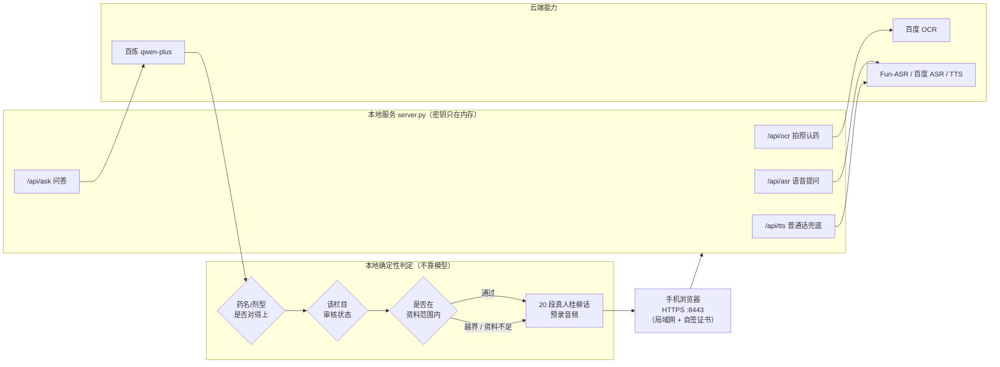

# 乡音药箱 · 方言用药播报助手

> 给广西农村留守老人用的「看药说话」工具：**拍一下药盒，用家乡话问一句，听到能听懂的答复**。

跑在本地的轻量服务。手机浏览器打开即用：拍照认药 → 语音提问 → 用**真人录制的桂柳话**念答案。
只依据说明书原文作答；资料里没有的，直接说「我不乱讲」。

<p align="center">
  <i>第八届国际青年人工智能大赛 · 广西赛区 · 创意组（IYAIC2026GX80214）</i>
</p>

---

## 解决什么问题

广西 60 岁以上人口超过 800 万，其中农村老人约占七成，多数与子女分居。七成以上老人同时在吃多种药，说明书却看不懂。

**不是「不会用手机」的问题，是产品从一开始就没为他们设计。**

三个堵点，三种应对：

| 堵点 | 常见做法 | 这里的做法 |
|---|---|---|
| 看不清小字、不懂术语 | 把字放大 | 直接**念出来**，用老人自己的话 |
| 只能听懂家乡话 | 逼老人说普通话 | 提问用带口音普通话也行，**答复用桂柳话播** |
| 不敢信 AI 说的话 | 让模型自由发挥 | **只念说明书原文**，没有就说没有 |

---

## 一个关键取舍：乡音只放在「播报侧」

这是整个项目最核心的决定。

让机器**听懂**方言和**说出**方言，难度根本不对等：方言语音识别已有可用服务，而方言语音合成几乎没有商用接口。

但真正决定取舍的不是技术难度，是**风险不对称**：

- 如果放在**提问侧**——老人说了什么、系统听错了，**老人自己察觉不到**，照着答案吃药，这是用药事故。
- 放在**播报侧**——说出来的话听错了，老人**当场就听得出来**（"这句不对劲"），可以重问、可以找人问。

> 所以这个项目**主动把风险放在「老人能察觉」的那一侧**。这不是能力妥协，是安全取舍。

配套的两条：

- 老人**听得懂**普通话、也**说得出**带口音的普通话，只是**听**家乡话最顺。所以取各自最长的板：输入用普通话（识别成熟），输出用方言（理解最顺）。
- 20 段桂柳话是**真人录制**的，不是 AI 合成。播报侧的内容，我们能逐字担保。

---

## 系统结构



三个设计要点：

1. **密钥不下发前端。** 三套接口密钥只存在于本地服务进程内存里，网页端（F12 也看不到）拿不到任何一个。前端调用一律走相对路径，换网络只重启服务、不改代码。
2. **判断该不该回答，由代码决定，不是模型。** 药名与剂型是否匹配、该栏目是否通过审核、问题是否在资料范围内——三种判定都在 Python 里用确定性规则完成。
3. **拒答也有声音。** 拒答不是"不播"，而是播一句通用安全话术（"资料里没有，我不乱讲"）。**拒答时绝不会继续念正常用法**，这条单独做了验证。

---

## 安全设计

用药场景里，"不给错误答案"比"多答对一个"重要得多。所以做了几层**失效即拒答**的保护：

| 保护 | 做法 |
|---|---|
| 身份硬校验 | 药盒印的是「硝苯地平缓释片」，资料库只有「硝苯地平片」（普通片）时——**拒绝套用**。两种剂型剂量完全不同，模糊匹配会直接造成用药事故 |
| 栏目级审核 | 每种药、每个栏目（用法用量 / 禁忌 / 不良反应…）都有独立审核状态，未通过的栏目**连文字都不给** |
| 剂量不重写 | 用法用量直接取说明书原文，**不由模型改写数字** |
| 拒答话术不带剂量 | 拒答模板里出现任何剂量数字都算失败。这条是拿真实评测抓出来的问题 |
| 录音白名单 | 20 段乡音不是"匹配到就播"。资料矛盾或未经逐句核验的录音登记为**禁用**，前端有一致性闸校验 |
| 缺配置就停 | 密钥文件缺失或格式不对时，服务**拒绝启动**，而不是带着空配置跑 |

---

## 评测与验证

**先说范围**：以下数字只对应「本次测试的 5 种药、20 道题」，**不代表在任意药品、任意问法上普遍准确**。

- 20 道题 = 15 道正常题（覆盖 5 种实物药的治什么 / 怎么吃 / 谁不能吃）+ 5 道越界题（过量、误服、超范围、非本药品）
- 迭代至第 20 轮，其中 **18 轮明细留档**；第 8~13 轮均为 **15/15 正常题 + 5/5 拒答题**
- 另有 1 轮改版后复测（界面改版 + 乡音接入 + 资料截断标注之后重跑）：**仍为 15/15 + 5/5，自检 26/26**
- 一轮 20 题的模型调用实测花费 **0.11 元**（折合单次约 0.006 元），**不含** OCR / ASR / TTS 与部署成本

评测方式是人工对照说明书原文判分。有一个诚实的发现：早期评测报出过「假通过」——模型靠自己的知识答对了，而正确答案根本不在资料库里。追查后补齐了资料栏目，才算真达标。

**没有做的验证**：

- 不是医疗器械，**未做临床有效性验证**
- 只覆盖 5 种药，不是全部常用药
- 20 段乡音覆盖固定问法，**不是任意问法都能播方言**（匹配不到就退回普通话 TTS）
- 未在真实老人长期使用场景下测试

---

## 目录结构

```
.
├── 02_代码/                  # 服务端 + 前端 + 验证脚本（49 个文件）
│   ├── server.py             # 主服务：三路接口 + 确定性安全护栏
│   ├── index.html            # 手机端主界面（分步问药）
│   ├── admin.html            # 后台看板（地区问药活跃度 / 人工审核）
│   ├── ui_presentation.js    # 分步流程与状态机
│   ├── ui_steps.css          # 适老化视觉层
│   ├── ui_assets/            # 内联 SVG 图标
│   ├── recorder.js           # 按住说话（自采 PCM 编 WAV）
│   ├── stat_store.py         # 统计（口径：问药完成次数，非用户数）
│   ├── review_store.py       # 人工审核
│   ├── region_lookup.py      # 地区（老人手选，不用 GPS）
│   ├── asr_service.py        # Fun-ASR 封装
│   ├── preflight.py          # 启动前体检
│   └── verify_*.py           # 离线回归与安全验证（十几个）
├── 01_资料/
│   ├── 方言录音/             # 20 段真人桂柳话（mp3）
│   ├── 药品数据.json         # 从说明书抽取的结构化资料
│   ├── 药品审核状态.json     # 栏目级审核状态 + 播报禁用登记
│   ├── 测试集.csv            # 20 道评测题
│   ├── 03_药品说明书/        # 说明书文字整理稿
│   └── 密钥填写说明.md       # ★ 跑起来之前先看这个
├── 03_使用说明/              # 每轮改动的验收记录
└── ★_1~★_4 启动脚本
```

---

## 本地运行

**前提**：Python 3、Chrome 或 Edge、能联网（三路云接口）。

```bash
# 1. 放入自己的密钥（本仓库不含任何密钥，缺失时服务会拒绝启动）
#    在 01_资料/ 下创建 4 个 txt，格式见 01_资料/密钥填写说明.md

# 2. 启动
python 02_代码/server.py

# 3. 浏览器打开（本机访问不需要证书）
#    http://127.0.0.1:8000
```

Windows 下也可以直接双击根目录的 `★_1_启动演示_电脑窗口.bat`。

手机访问需要 HTTPS：用 openssl 生成自签 CA 与服务器证书（SAN 里写上本机 IP），手机装一次 CA 即可长期信任。本仓库出于安全考虑**不包含任何证书与私钥**。

---

## 关于「AI 用在哪」

这个项目用大模型，但**刻意把它放在很窄的位置**：

- 模型负责：把说明书原文，改写成老人听得懂的一两句话
- 模型**不负责**：判断该不该回答、决定剂量、决定播哪段录音

前者是"表达"，错了老人听得出来；后者是"判断"，错了没人能兜住。**能用确定性代码判的，就不交给模型。**

---

## 声明

本项目为竞赛作品与技术演示，**不构成医疗建议，不能替代医生或药师**。
药品资料来自实物说明书，仅用于本项目演示；如需用药请遵医嘱。
